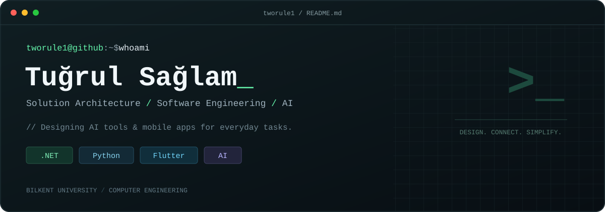

<p align="center">
  
</p>

### `> cat about.md`

I'm **Tuğrul**, a Computer Engineering graduate from **Bilkent University**, working across **solution architecture, software engineering, and AI**.

I design **AI tools and mobile applications that make everyday tasks easier**. My focus is on connecting the user experience, application logic, and AI capabilities into a coherent solution — from the first idea to the architecture behind it.

My core stack is **.NET**, **Python**, and **Flutter**.

### `> ls focus/`

- **Solution architecture** — shaping how the parts of an application fit together around a real user need.
- **AI for everyday tasks** — designing practical tools that simplify everyday workflows.
- **Mobile experiences** — designing Flutter applications that bring useful AI tools into everyday life.

### `> python profile.py`

```python
profile = {
    "handle": "tworule1",
    "focus": ["Solution Architecture", "Software Engineering", "AI"],
    "designing": ["Everyday AI tools", "Mobile applications"],
    "stack": [".NET", "Python", "Flutter"],
    "education": "Bilkent University · Computer Engineering",
}
```

### `> ls stack/`

<p>
  
  
  
</p>

### `> open connections`

[LinkedIn](https://www.linkedin.com/in/tugrulsaglam/) · [GitHub repositories](https://github.com/tworule1?tab=repositories)

---

`$ echo "Less friction. More possibility."`


