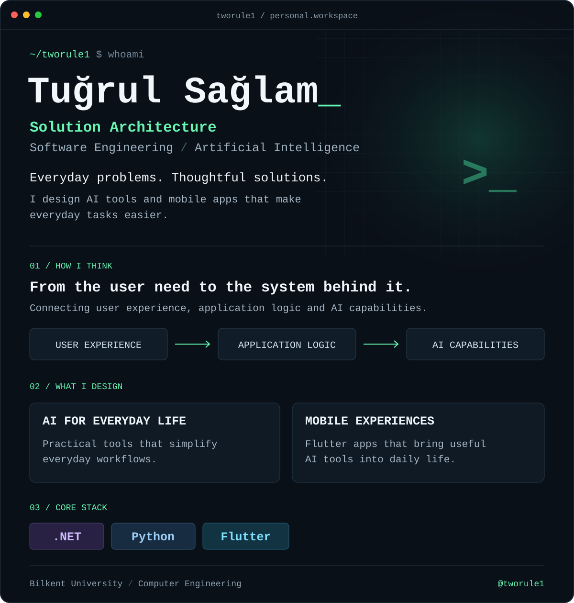

  

  
  

Read profile as text

I'm **Tuğrul Sağlam**, a Computer Engineering graduate from **Bilkent University**, working across **solution architecture, software engineering, and AI**.

I design **AI tools and mobile applications that make everyday tasks easier**, connecting user experience, application logic, and AI capabilities.

- **Solution architecture:** shaping how the parts of an application fit together around a real user need.
- **AI for everyday tasks:** practical tools that simplify everyday workflows.
- **Mobile experiences:** Flutter applications that bring useful AI tools into daily life.
- **Core stack:** .NET, Python, Flutter.

[LinkedIn](https://www.linkedin.com/in/tugrulsaglam/) · [GitHub repositories](https://github.com/tworule1?tab=repositories)

